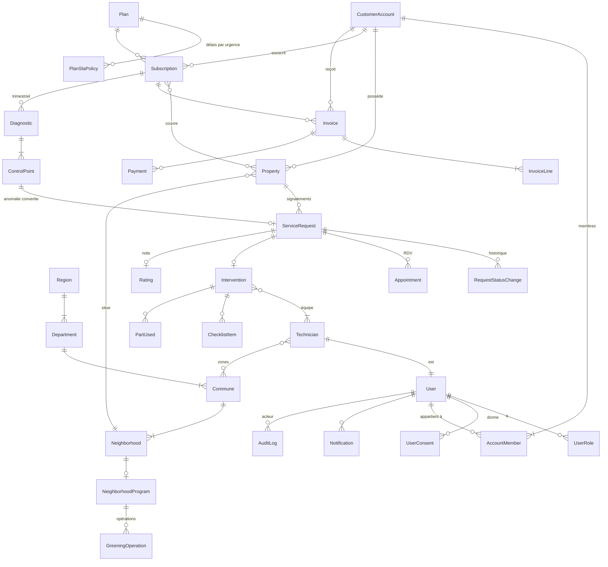
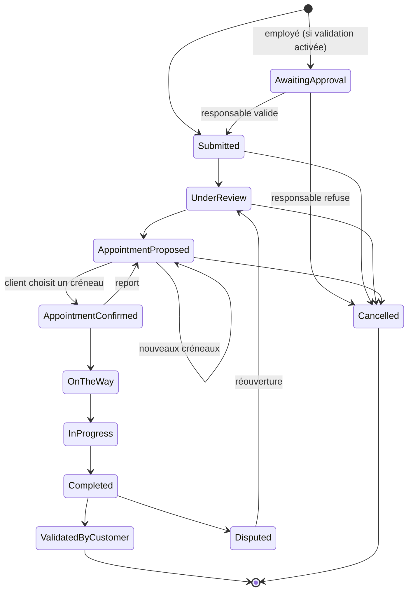

# SENECARE — Modèle de domaine (Phase 1, proposition)

> Statut : **validé, implémenté en Phase 1**. Noms techniques en anglais, explications en français.
> Montants : `Money` = entier `long` en XOF (FCFA), jamais de décimales.
> Dates : stockées en UTC (`DateTimeOffset`), affichées en Africa/Dakar (UTC+0).

**Décisions validées (12/10/2026)**
- Un seul `CustomerAccount` (Household / Business) ; un « site » est une `Property` d'un compte Business.
- Particuliers : abonnement **par logement** couvert.
- Entreprises : période de facturation **trimestrielle** (3 × tarif mensuel), facture émise seulement après diagnostic validé.
- Identité : **ASP.NET Identity** (`IdentityUser<Guid>`) dans Infrastructure, même Id que `User` du Domain.

## 1. Vue d'ensemble des entités

`MediaFile` (photos, note vocale, signature, PDF) est référencé par Property, ServiceRequest,
Intervention, Diagnostic et GreeningOperation. Il n'apparaît pas ci-dessus pour garder le schéma lisible.

## 2. Détail par agrégat

### Identité
| Entité | Champs principaux |
|---|---|
| **User** | Id, `PhoneNumber` (VO, +221 normalisé, unique), FullName, Email?, PreferredLanguage (fr/wo), IsActive, CreatedAt |
| **UserRole** | PlatformRole : `Customer`, `Technician`, `SuperAdmin`, `Dispatcher`, `Finance`, `Support` |
| **UserConsent** | Type (données personnelles, WhatsApp, marketing), PolicyVersion, GivenAt, WithdrawnAt? (loi 2008-12) |

### Comptes clients (particulier **et** entreprise)
| Entité | Champs principaux |
|---|---|
| **CustomerAccount** | Kind : `Household` / `Business`, DisplayName, NINEA? (entreprise), BillingPhone |
| **AccountMember** | UserId, AccountRole : `Owner`, `Manager`, `SiteManager`, `Reporter`, PropertyScope (sites autorisés pour SiteManager/Reporter) |
| **Property** | Kind : `House`, `Villa`, `Apartment`, `Office`, `Shop`, `Warehouse`, `Other` ; Name ; `Address` (VO) ; Photos |

`Address` (VO) = NeighborhoodId + `GeoPoint` (lat/lng) + Landmark (« derrière la mosquée, portail vert ») + Details?.

→ « Organization » = `CustomerAccount` de type Business ; « Site » = `Property` d'un compte Business.

### Référentiel géographique (seedé)
Region → Department → Commune → Neighborhood (Name, Slug).

### Offres et facturation
| Entité | Champs principaux |
|---|---|
| **Plan** | Code (HOME, ESSENTIEL, PRO, PREMIUM), Segment, RegistrationFee, MonthlyPrice, BillingPeriodMonths, DiagnosticRequired, DiagnosticIntervalMonths, MaxVisitsPerPeriod?, Priority, IncludedDomains, IsActive |
| **PlanSlaPolicy** | Urgency → délai max (ex : Critique 4 h). Permet des délais différents par offre |
| **Subscription** | AccountId, PlanId, Status, PriceSnapshot (prix figé à la souscription), CurrentPeriod (début/fin), NextDueDate, CoveredProperties |
| **Invoice** | Number (`FAC-2026-000123`), Period, Lines, Total, DueDate, Status : `Draft`, `Issued`, `Paid`, `Overdue`, `Cancelled` |
| **Payment** | Amount, Channel : `Wave`, `OrangeMoney`, `FreeMoney`, `Cash`, `BankTransfer` ; Status ; ProviderReference ; RecordedBy? (saisie manuelle) |

Statuts d'abonnement : `PendingRegistration` → `Active` ⇄ `PastDue` → `Suspended` → `Cancelled`.

### Signalement → intervention
| Entité | Champs principaux |
|---|---|
| **ServiceRequest** | Number (`SC-2026-000123`), PropertyId, ReportedBy, Domain, Description, Urgency, Status, Photos, VoiceNote?, PreferredSlots, SubmittedAt, **SlaDeadline** |
| **RequestStatusChange** | From, To, At, ByUserId, Comment? (historique horodaté) |
| **Appointment** | ProposedSlots (`TimeSlot` VO), ChosenSlot?, Status : `Proposed`, `Confirmed`, `Cancelled` |
| **Intervention** | Lead technician + équipe, ChecklistItems, Photos avant/après, PartsUsed, StartedAt, CompletedAt, CustomerSignature, Report, **WarrantyEndsOn** |
| **Rating** | Score 1–5, Comment |

Domaines : `Electricity`, `Plumbing`, `Waterproofing`, `Masonry`, `Carpentry`, `Security`, `Outdoor`.
Urgences : `Critical` (< 4 h), `High` (< 24 h), `Normal` (< 72 h), `Planned` (sans délai).

### Diagnostic trimestriel (entreprises)
| Entité | Champs principaux |
|---|---|
| **Diagnostic** | SubscriptionId, PeriodCovered, ScheduledFor, Status : `Planned`, `InProgress`, `Submitted`, `Validated`, Recommendations, Report PDF |
| **ControlPoint** | Domain, Label, Result : `Ok`, `Anomaly`, `NotApplicable` ; Comment ; Photos ; ConvertedRequestId? |

### Techniciens
**Technician** : UserId, Skills (domaines), Zones (communes), WeeklyAvailability, Unavailabilities, IsCertified, AverageRating.

### Programme Quartiers
**NeighborhoodProgram** : NeighborhoodId, MemberCount, Threshold (500 par défaut, paramétrable), Status : `Gathering` / `Active`.
**GreeningOperation** : Date, TreesPlanted, Description, Photos.

### Transverse
- **Notification** : UserId, Channel, Template, Status, SentAt, Error.
- **AuditLog** : ActorId, Action, EntityType, EntityId, At, Ip, IsSensitiveData.
- **AppSetting** : délai de grâce, seuil quartier par défaut… (paramétrable par l'admin).

## 3. Cycle de vie d'un signalement

Ajouts par rapport au cahier : `AwaitingApproval` (circuit entreprise, Phase 7) et `Cancelled`.
Pour une urgence critique, le dispatcher peut passer directement de `UnderReview` à `AppointmentConfirmed` (intervention immédiate).
Une demande `Completed` sans réponse du client au bout de N jours (paramétrable) passe automatiquement à `ValidatedByCustomer`.

## 4. Règles métier portées par le Domain (testées unitairement)
1. **Machine à états** : toute transition non listée lève une `DomainException` ; chaque transition ajoute une ligne d'historique.
2. **SLA** : `SlaDeadline = SubmittedAt + délai(Plan, Urgency)` ; `IsSlaBreached(now)` ; le délai repart si l'urgence est requalifiée.
3. **Renouvellement entreprise** : `Subscription.StartNextPeriod()` refuse si le plan exige un diagnostic et qu'aucun diagnostic `Validated` ne couvre la période qui se termine.
4. **Abonnement** : l'inscription n'est réglée qu'une fois ; passage `PastDue` à l'échéance, `Suspended` après le délai de grâce, réactivation au paiement.
5. **Facture** : totale = somme des lignes ; `Paid` quand les paiements confirmés couvrent le total ; montants toujours ≥ 0 et entiers.
6. **Garantie** : `WarrantyEndsOn` fixée à la clôture ; un nouveau signalement sur le même domaine et logement pendant la garantie est marqué « sous garantie ».
7. **Programme Quartiers** : passe `Active` quand `MemberCount ≥ Threshold`.
8. **Téléphone** : préfixes 77/78/76/70/75, 9 chiffres, stocké en `+221XXXXXXXXX`.
9. **Notation** : uniquement après `Completed`, une seule fois, par un membre du compte.

## 5. Paramètres par défaut (table `app_settings`, modifiables par l'admin)
| Clé | Défaut | Rôle |
|---|---|---|
| `billing.grace_days` | 7 | Jours de grâce après l'échéance avant suspension |
| `requests.auto_validate_after_days` | 3 | Validation automatique d'une intervention terminée sans réponse |
| `interventions.warranty_days` | 90 | Durée de garantie d'une intervention |
| `neighborhoods.default_threshold` | 500 | Seuil d'adhérents du Programme Quartiers |

Ces valeurs (sauf 500) sont des hypothèses de départ à confirmer.
